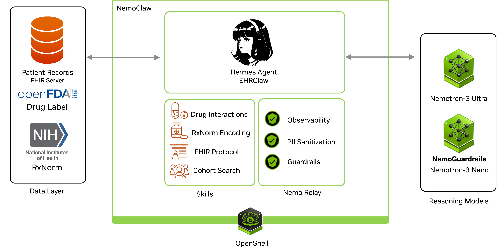

# CliniClaw

## Running this for BaC?

`./bac_setup.sh` does every step in this README for you, end to end, using the local vLLM model:

```bash
./bac_setup.sh
```

> If you get an Openshell timeout error, running the script again usually should work.


It installs the NemoClaw CLI if it's missing, downloads and extracts the synthetic patient data, starts the FHIR server and loads the bundles into it, brings up local vLLM, then builds the Hermes image and onboards the `hermes-health` sandbox.

The first run takes a while — it pulls the vLLM image and downloads the model weights into `~/hf-cache`. Those logs stream to `logs/vllm.log`, so `tail -f logs/vllm.log` is the place to look if it seems stuck.

When it finishes, open the dashboard at **http://127.0.0.1:8090**!

Tear it all down with `./scripts/shutdown.sh`.

The rest of this README covers the same steps manually, plus how the pieces fit together.

## About

A patient's records can be dense and sprawling, spanning many visits and years of history that take real time to read through. CliniClaw helps clinicians cut through that: get a quick snapshot or ask a specific question and get an answer in seconds — so physicians can spend more time giving care and listening to patients, and less time navigating charts.

CliniClaw is a safe, sandboxed agent for exploring patient health records. Ask it questions in plain language and it looks up the answer from a patient's chart: labs, medications, conditions, visits, and more, while staying strictly within safe boundaries: it retrieves and reports information, but never gives medical advice. It can also check a patient's medications against a drug's labeling for interactions, warnings, and contraindications. Physicians may also ask the agent to prescribe drugs to the patient in natural language, and CliniClaw resolves it to the right drug concept (RxNorm CUI), builds the underlying FHIR request, and writes it to the record for the patient. And given a clinical trial's criteria, it can prescreen the patient population to surface potential matches, each backed by evidence from the record, to help shortlist candidates worth a closer look.



## Components

| Component | Purpose |
|---|---|
| NemoClaw / OpenShell | Secure agent execution, tool isolation, network policy, and credential injection at the egress boundary |
| Hermes | Agent runtime and skill orchestration |
| NeMo Relay | Traces the agent's LLM/tool workflow (ATOF/ATIF exports) and manages adaptive execution, with NemoGuardrails plugin |
| NeMo Guardrails | Blocks medical advice / drug recommendation requests |
| HAPI FHIR | Stores and serves the patient / clinical records (FHIR R4) |

## FHIR Server

This project runs a local **FHIR R4** server using [HAPI FHIR](https://hapifhir.io/) with PostgreSQL. Sample patient records live in `data/` and come from [Synthea](https://synthea.mitre.org/downloads), hosted as [`aalmahrooqi/synthetic-fhir-data`](https://huggingface.co/datasets/aalmahrooqi/synthetic-fhir-data).

## Requirements

- **Python 3** — standard library only, used by `scripts/load_synthea.py` and the dashboard
- **Docker**
- [**NemoClaw**](https://github.com/NVIDIA/NemoClaw) v0.0.97:
```
curl -fsSL https://www.nvidia.com/nemoclaw.sh | \
  NEMOCLAW_INSTALL_REF= \
  NEMOCLAW_INSTALL_TAG=v0.0.97 \
  bash
  ```

### 1. Download Sample Data

Download the Synthea FHIR bundles from [Hugging Face](https://huggingface.co/datasets/aalmahrooqi/synthetic-fhir-data) and extract them into `data/`:

```bash
curl -L -o data.zip "https://huggingface.co/datasets/aalmahrooqi/synthetic-fhir-data/resolve/main/data.zip" && unzip -q data.zip
```


### 2. Start the server

```bash
docker compose up -d
```

The server listens on **http://localhost:8081**

Sanity check:
```bash
curl -s 'http://localhost:8081/fhir/Patient?_summary=count'
```

### 3. Load Synthea data

With the server running, upload the bundles from `data/`:

```bash
python3 scripts/load_synthea.py --data-dir data
```

This posts each Synthea transaction bundle to the FHIR API. The first full load takes a few minutes.

## Agent Setup

The Hermes agent runs in an OpenShell sandbox managed by the **NemoClaw** CLI.

### Quick install

From the repo root, run the startup script that matches your inference setup:

| Script | Inference provider |
|---|---|
| `./scripts/startup_w_inference_api.sh` | NVIDIA-hosted API — set `COMPATIBLE_API_KEY` in the script first |
| `./scripts/startup_w_local_model.sh` | Local vLLM on port 8000 — start it first with `scripts/run_vllm.sh` |

Each one exports its provider settings and then calls `scripts/setup_helper.sh`, which builds the vendored Hermes image (with [`nemo-relay`](https://github.com/NVIDIA/NeMo-Relay) baked in) and onboards a fresh `hermes-health` sandbox non-interactively.

Once it finishes, connect and start chatting:

```bash
nemoclaw hermes-health connect
sandbox$ hermes chat
```

To stop the FHIR server, the dashboard, and the local vLLM container:

```bash
./scripts/shutdown.sh
```

## Trace Dashboard

A lightweight web dashboard for watching the agent work and interacting with it. It has three tabs:

- **traces** — live stream of the agent's [ATOF](https://docs.nvidia.com/nemo/relay/) trace events (LLM calls, tool/skill usage, guardrail checks) from the sandbox, with a per-file browser, pretty JSON rendering, and raw `.jsonl` download.
- **chat** — a custom chat UI that talks to the Hermes agent through the gateway, with streaming responses.
- **hermes** — the native Hermes dashboard, embedded.

With the `hermes-health` sandbox running, start it with Docker Compose:

```bash
docker compose -f docker-compose.dashboard.yaml up --build -d
```

Then open **http://127.0.0.1:8090**. To stop it: `docker compose -f docker-compose.dashboard.yaml down`.


## NeMo Guardrails

[NeMo Guardrails](https://github.com/NVIDIA/NeMo-Guardrails) keeps the assistant on-task — it blocks the agent from giving medical advice or drug recommendations, so it stays a data-retrieval tool rather than a clinical decision-maker.

It's integrated through **NeMo Relay** ([Nemo Guardrails Plugin](https://docs.nvidia.com/nemo/relay/configure-plugins/nemo-guardrails/about)), and runs in **local** mode, so NeMo Relay spawns an in-sandbox Python worker that applies self-check input/output rails (defined in `configs/nemo_guardrails/config.yaml`) to every managed LLM turn. The self-check calls the same OpenShell-managed inference route as the agent, so no API key ever lives in the sandbox.

The local backend requires `nemoguardrails==0.22.0`, which depends on `annoy` — a package that ships source-only on PyPI (no prebuilt wheel for Python 3.13). Since the hardened sandbox image has no C/C++ compiler, we vendor a prebuilt `annoy` wheel under `vendor/wheels/` and install from it at build time so nothing needs to compile inside the image.

## Skills

Agent skills live under `agents/ehr-expert/skills/`. Each skill documents how the agent queries an external data source.

### FHIR Data Access

Reads patient and clinical data from the local HAPI FHIR R4 server (patients, observations, medications, encounters, conditions, etc.) via its REST API. See [HAPI FHIR](https://hapifhir.io/).

### RxNorm Resolve CUI

Normalizes free-text medication names to [RxNorm](https://www.nlm.nih.gov/research/umls/rxnorm/index.html) concepts using the NLM [RxNav](https://rxnav.nlm.nih.gov/) API. Returns an RxCUI plus ambiguity notes when a name does not map cleanly.

Example:

```text
Input: Ambien

Resolved concept:
- RxCUI: 131725
- RxNorm name: Ambien
- Confidence: high
```

### Drug Interaction Label Check

Fetches FDA drug labeling for a known RxCUI from [openFDA](https://open.fda.gov/) and summarizes interaction-related label text (e.g. drug interactions, boxed warnings, contraindications). This is a single-drug label lookup, not a pairwise interaction checker.

### Clinical Trial Cohort Prescreener

Prescreens patients in the FHIR dataset against a single clinical trial's inclusion/exclusion criteria (supplied as text) and reports **potential matches** with supporting evidence. Builds on the FHIR Data Access skill: it derives a coarse candidate cohort (by condition, age, and sex), evaluates each criterion against the record, and returns a per-patient result matrix. It never declares a patient definitively *eligible* — final eligibility must be confirmed by the trial research team.

## Disclaimers
*This demo is not intended to be used in a clinical setting or for actual patient care. It is a technical demonstration only and does not provide medical advice, diagnosis, or treatment. All patient records are synthetic and do not represent real individuals. This product uses publicly available data from the U.S. National Library of Medicine (NLM), National Institutes of Health, Department of Health and Human Services; NLM is not responsible for the product and does not endorse or recommend this or any other product.*
